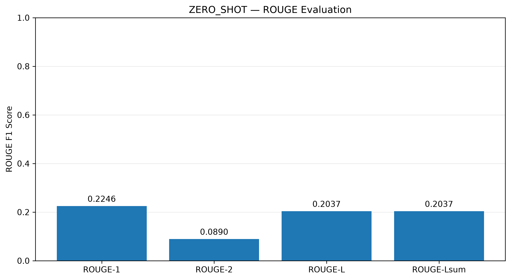
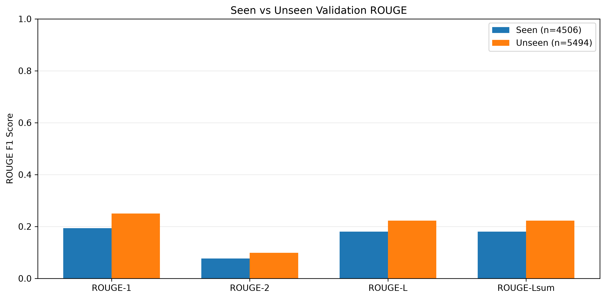
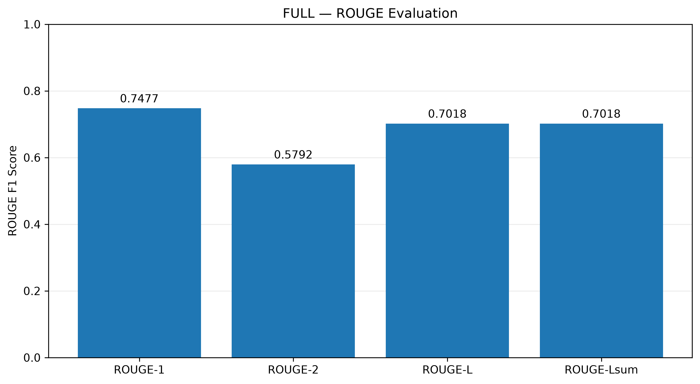
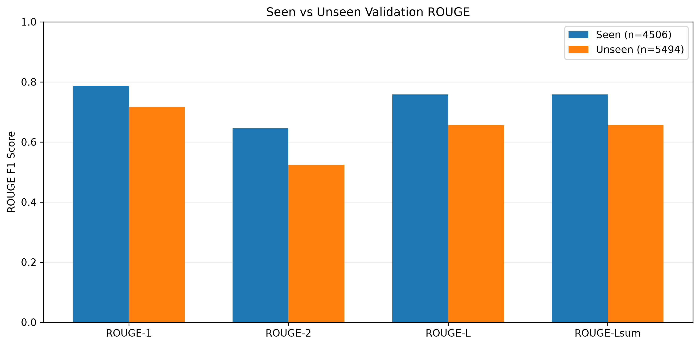
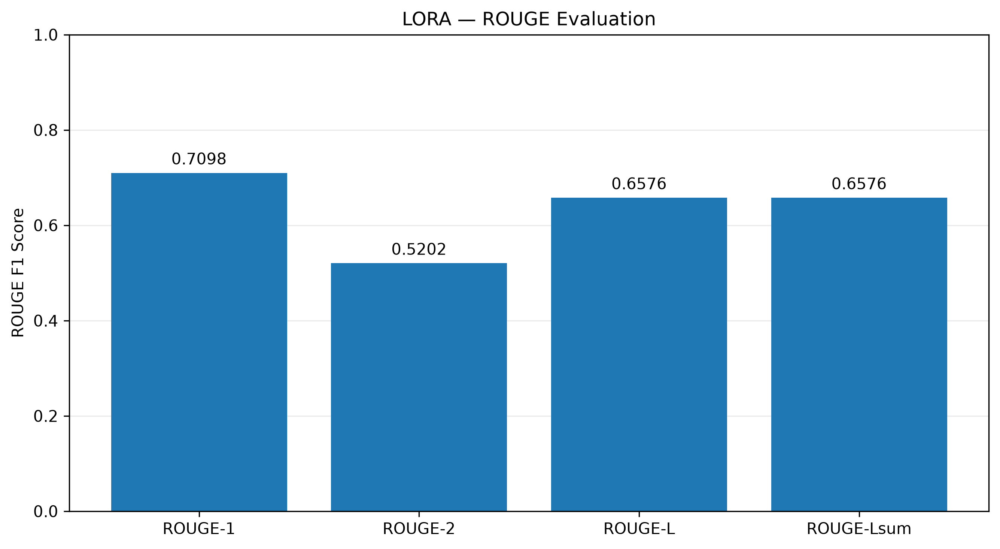
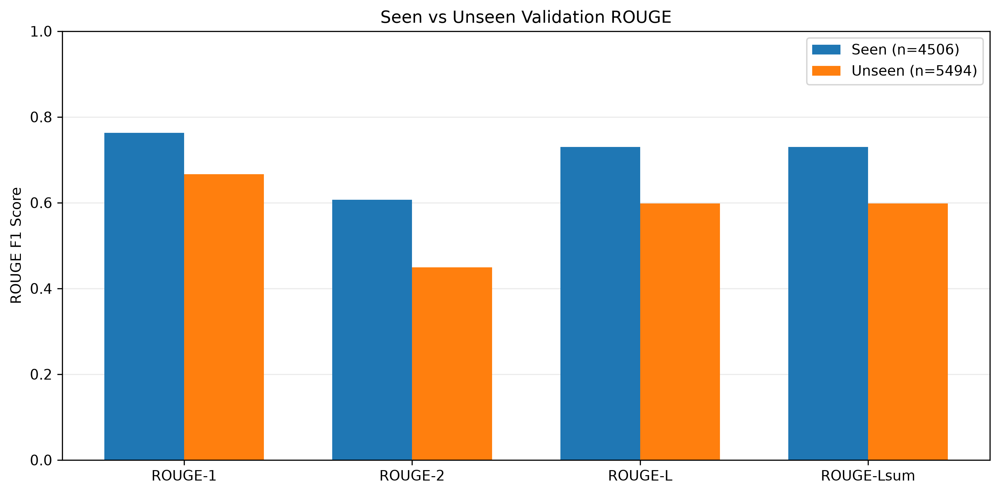

# Radiology Report Summarisation Using FLAN-T5: Full Fine-Tuning vs LoRA

**Author:** Tran Minh Quang Nguyen - 50124769

## Table of Contents

1. [Introduction](#1-introduction)
   - [1.1 Background and Problem](#11-background-and-problem)
   - [1.2 Objectives and Research Question](#12-objectives-and-research-question)
   - [1.3 Proposed Approach](#13-proposed-approach)
2. [Feasibility Review](#2-feasibility-review)
3. [Dataset and Preprocessing](#3-dataset-and-preprocessing)
   - [3.1 Dataset and Preprocessing](#31-dataset-and-preprocessing)
   - [3.2 Data Leakage Analysis](#32-data-leakage-analysis)
4. [Methodology](#4-methodology)
   - [4.1 Model and Fine-Tuning Strategies](#41-model-and-fine-tuning-strategies)
   - [4.2 Training and Experimental Setup](#42-training-and-experimental-setup)
5. [Results and Evaluation](#5-results-and-evaluation)
   - [5.1 Evaluation Metrics](#51-evaluation-metrics)
   - [5.2 Summarisation Performance](#52-summarisation-performance)
   - [5.3 Computational Efficiency](#53-computational-efficiency)
6. [Clinical Safety Analysis](#6-clinical-safety-analysis)
   - [6.1 Qualitative Error Analysis](#61-qualitative-error-analysis)
   - [6.2 Failure Patterns and Root Causes](#62-failure-patterns-and-root-causes)
   - [6.3 Recommendations and Limitations](#63-recommendations-and-limitations)
7. [Reproducibility](#7-reproducibility)
   - [7.1 Environment and Dependencies](#71-environment-and-dependencies)
   - [7.2 Training and Evaluation Instructions](#72-training-and-evaluation-instructions)
8. [Conclusion](#8-conclusion)
9. [References](#9-references)
10. [AI Usage Disclosure](#10-ai-usage-disclosure)

## 1. Introduction

### 1.1 Background and Problem

Radiology reports contain essential diagnostic information but often use specialised terminology that patients may struggle to understand. Generating patient-friendly summaries can improve accessibility, but clinical accuracy remains critical: hallucinated findings, omitted information, or altered diagnostic certainty may lead to misinterpretation [7].

This project investigates **FLAN-T5 Base** for radiology report summarisation using the **BioLaySumm2025 LaymanRRG** dataset [1]. Building on previous T5-based approaches to radiology summarisation [6], it compares **Full Fine-Tuning (Full FT)** and **Low-Rank Adaptation (LoRA)** in terms of summarisation quality, computational efficiency, and clinical reliability.

### 1.2 Objectives and Research Question

**Research question:** Can LoRA achieve summarisation quality comparable to Full FT with substantially fewer trainable parameters, while maintaining clinical reliability?

The project aims to:

1. Compare **zero-shot, LoRA, and Full FT** using ROUGE-1, ROUGE-2, ROUGE-L, and ROUGE-Lsum.
2. Measure computational efficiency through trainable parameters, GPU memory usage, training time, and inference performance.
3. Investigate training–validation data overlap and its impact on evaluation reliability.
4. Analyse clinical safety through hallucinations, omissions, and readability.

### 1.3 Proposed Approach

The project uses **FLAN-T5 Base**, an instruction-tuned encoder-decoder Transformer [2, 3], with three configurations:

- **Zero-shot:** Pretrained model without task-specific training.
- **Full FT:** Updates all pretrained model parameters.
- **LoRA:** Trains lightweight low-rank adapters while keeping pretrained weights frozen [4].

All configurations follow a consistent preprocessing and evaluation pipeline. Summarisation quality is assessed using ROUGE [5], while computational profiling and qualitative clinical safety analysis provide complementary evidence beyond lexical similarity.

The overall workflow is illustrated in Figure 1.

<p align="center">
  
</p>

<p align="center">
  <em>Figure 1. Overview of the FLAN-T5 radiology report summarisation pipeline, comparing zero-shot inference, Full FT, and LoRA.</em>
</p>

## 2. Feasibility Review

### Problem, User Need and Scope

Radiology reports contain specialised medical terminology that can be difficult for non-expert readers to understand. This project aims to generate layperson-friendly summaries while preserving clinically important findings.

The scope is text-to-text summarisation using the official BioLaySumm2025 LaymanRRG dataset. The project focuses on fine-tuning, quantitative evaluation, and clinical safety analysis, rather than image interpretation or clinical deployment.

### Measurable Acceptance Criteria

1. Implement a reproducible FLAN-T5 fine-tuning pipeline with a custom PyTorch training loop (without the Hugging Face Trainer API).
2. Evaluate pretrained and LoRA-fine-tuned models using ROUGE-1, ROUGE-2, and ROUGE-L, targeting an improvement in ROUGE-L over the pretrained baseline.
3. Report results on both the full validation set (10,000 records) and the unseen-report subset (5,494 records).
4. Analyse 3–5 validation examples for factual hallucinations, critical omissions, and readability.
5. Complete training within the available GPU budget, documenting runtime, peak GPU memory, and configuration.

### Technical Approach and Related Work

The BioLaySumm 2025 shared task establishes the radiology-to-layperson summarisation setting [1]. This project adopts FLAN-T5 Base, building on the text-to-text Transformer framework [2] and instruction fine-tuning [3].

Low-Rank Adaptation (LoRA) [4] will be used for parameter-efficient fine-tuning. A custom PyTorch training loop will be implemented without the Hugging Face Trainer API.

Model performance will be assessed using ROUGE [5], alongside qualitative analysis of clinical accuracy and readability.

### Preliminary Feasibility Evidence

The official BioLaySumm2025 LaymanRRG dataset [1] was successfully loaded and audited on Google Colab. It contains 150,454 training, 10,000 validation, and 10,537 test records.

A case-insensitive, whitespace-normalised exact-match audit identified **2,150 unique reports** shared between training and validation, affecting **4,506 validation records (45.06%)**. Furthermore, 12,154 unique training reports have multiple distinct target summaries. All test records lack reference summaries.

These findings highlight a potential evaluation bias from report overlap. The official splits will be preserved, and ROUGE will be reported on both the full validation set and the **5,494-record unseen-report subset**. GPU feasibility and model performance remain to be verified.

### Risks, Resources and Fallback

| Risk | Mitigation Strategy |
|---|---|
| **Data overlap** | Compare ROUGE on the full validation set against the unseen-report subset. |
| **Clinical accuracy** | Examine unsupported statements, critical omissions, and readability in qualitative cases. |
| **GPU budget** | Target a single Colab GPU with LoRA, batch size 4, and up to 3 epochs. Record peak VRAM and training time. Reduce batch size to 1 with gradient accumulation if memory is insufficient. |
| **Time constraints** | Prioritise a working baseline, reproducible fine-tuning, and evaluation before optional hyperparameter experiments. |

## 3. Dataset and Preprocessing

### 3.1 Dataset and Preprocessing

This project uses the **BioLaySumm2025 LaymanRRG** dataset [1], containing radiology reports and their corresponding patient-friendly summaries. The dataset provides four fields: `source`, `images_path`, `radiology_report`, and `layman_report`. Only the text fields are used, with `radiology_report` as the model input and `layman_report` as the target summary.

**Table 1. Official BioLaySumm2025 dataset splits.**

| Split | Records | Purpose |
|---|---:|---|
| Training | 150,454 | Model fine-tuning |
| Validation | 10,000 | Checkpoint selection and evaluation |
| Test | 10,537 | Unlabelled test set |
| **Total** | **170,991** | |

The official splits are preserved. Since test references are withheld, quantitative evaluation uses the validation set.

**Preprocessing.** Reports and summaries are tokenised using the pretrained FLAN-T5 tokenizer, with truncation to configured sequence lengths and dynamic padding within each batch. Target padding tokens are replaced with `-100` to exclude them from cross-entropy loss. A custom PyTorch `DataLoader` produces `input_ids`, `attention_mask`, and `labels`, with shuffled training batches and deterministic validation ordering. Both fine-tuning strategies use the same preprocessing pipeline.

### 3.2 Data Leakage Analysis

A case-insensitive, whitespace-normalised exact-match audit was conducted to detect report overlap between training and validation.

**Table 2. Training–validation overlap analysis.**

| Metric | Count |
|---|---:|
| Unique training reports | 93,505 |
| Unique validation reports | 7,599 |
| Unique reports shared between splits | 2,150 |
| Validation records with overlapping reports | 4,506 |
| Validation records with unseen reports | 5,494 |
| **Validation overlap rate** | **45.06%** |
| Training reports with multiple reference summaries | 12,154 |

**45.06% of validation records contain reports also present in training**, potentially inflating evaluation scores. Furthermore, 12,154 unique training reports have multiple distinct reference summaries, introducing ambiguity in the training targets.


<p align="center">
  <em>Figure 2. Distribution of overlapping (45.06%) and unseen (54.94%) validation reports.</em>
</p>


To assess the impact of overlap, ROUGE is evaluated on both the **full validation set (10,000 records)** and the **unseen-report subset (5,494 records)**. This comparison helps distinguish performance on previously encountered report text from generalisation to unseen reports.


## 4. Methodology

### 4.1 Model and Fine-Tuning Strategies

This project uses **FLAN-T5 Base** (`google/flan-t5-base`), a 247.58M-parameter instruction-tuned encoder-decoder Transformer [2, 3]. Three configurations are considered: **zero-shot**, **Full Fine-Tuning (Full FT)**, and **Low-Rank Adaptation (LoRA)**.

- **Zero-shot:** Uses the pretrained model without task-specific training.
- **Full FT:** Updates all 247,577,856 model parameters during training.
- **LoRA:** Freezes the pretrained weights and introduces trainable low-rank adapters into the attention query (`q`) and value (`v`) projections [4].

LoRA represents the adapted weight matrix as:

$$
W' = W_0 + \frac{\alpha}{r}BA
$$

where $W_0$ is the frozen pretrained weight matrix, $A$ and $B$ are trainable low-rank matrices, $r$ is the adapter rank, and $\alpha$ controls the update scaling.

**Table 3. Fine-tuning configurations.**

| Configuration | Trainable Parameters | Trainable (%) |
|---|---:|---:|
| Zero-shot | 0 | 0% |
| Full FT | 247,577,856 | 100% |
| LoRA ($r=8$, $\alpha=16$) | 884,736 | 0.3561% |

LoRA uses a dropout rate of **0.05** and targets the `q` and `v` projections. Compared with Full FT, it reduces trainable parameters by approximately **99.64%**.

### 4.2 Training and Experimental Setup

Both Full FT and LoRA were trained using a **custom PyTorch training loop**, without the Hugging Face Trainer API. The models minimise token-level cross-entropy loss:

$$
\mathcal{L}_{CE} = -\frac{1}{T}\sum_{t=1}^{T}
\log P_{\theta}(y_t \mid y_{<t}, x)
$$

where $x$ is the input radiology report, $y_t$ is the reference summary token, and $T$ is the number of valid target tokens. Padding labels (`-100`) are excluded from the loss.

**Table 4. Training hyperparameters.**

| Hyperparameter | Full FT | LoRA |
|---|---|---|
| Epochs | 3 | 3 |
| Batch size | 4 | 4 |
| Gradient accumulation | 4 | 4 |
| Effective batch size | 16 | 16 |
| Learning rate | 5e-5 | 1e-4 |
| Random seed | 42 | 42 |
| Hardware | NVIDIA A100 | NVIDIA A100 |

Gradient accumulation provides an effective batch size of $4 \times 4 = 16$, reducing per-step GPU memory requirements.

Experiments were conducted on the **UQ Rangpur HPC cluster**. Validation loss was recorded after each epoch, and the checkpoint with the lowest validation loss was selected for subsequent evaluation.

Both configurations showed decreasing training and validation losses over three epochs (Figures 3 and 4). Full FT achieved a lower final validation loss (0.4668) than LoRA (0.7654), indicating better optimisation under the tested configurations. Neither model exhibited an increase in validation loss during training.

| Full Fine-Tuning | LoRA |
|:---:|:---:|
|  |  |
| *Figure 3. Full FT training history.* | *Figure 4. LoRA training history.* |


## 5. Results and Evaluation
### 5.1 Evaluation Metrics

Summarisation quality is evaluated using **ROUGE-1, ROUGE-2, ROUGE-L, and ROUGE-Lsum** [5], measuring lexical overlap between generated and reference summaries. ROUGE F1 scores are reported for all three configurations.

**Table 5. Evaluation configuration.**

| Parameter | Value |
|---|---|
| Dataset | Official validation split (10,000 records) |
| Batch size | 8 |
| Decoding | Beam search (4 beams) |
| Maximum generated tokens | 128 |
| Hardware | NVIDIA A100 |

To assess the impact of training–validation overlap (Section 3.2), ROUGE is reported on the **full validation set (10,000)**, **seen subset (4,506)**, and **unseen subset (5,494)**.

Since validation data was also used for checkpoint selection, these results do not represent performance on an independent test set. Clinical reliability is examined separately in Section 6.

### 5.2 Summarisation Performance

All three configurations were evaluated on the full validation set of 10,000 records using identical generation settings.

**Table 6. ROUGE F1 scores on the full validation set.**

| Model | ROUGE-1 | ROUGE-2 | ROUGE-L | ROUGE-Lsum |
|---|---:|---:|---:|---:|
| Zero-shot | 0.2246 | 0.0890 | 0.2037 | 0.2037 |
| Full FT | **0.7477** | **0.5792** | **0.7018** | **0.7018** |
| LoRA | 0.7098 | 0.5202 | 0.6576 | 0.6576 |

Full FT achieved the highest scores across all metrics, followed by LoRA. Both fine-tuned models substantially outperformed the zero-shot baseline.

**Table 7. Seen vs unseen ROUGE-L comparison.**

| Model | Seen (4,506) | Unseen (5,494) | Gap (Seen − Unseen) |
|---|---:|---:|---:|
| Zero-shot | 0.1803 | 0.2228 | -0.0425 |
| Full FT | **0.7580** | **0.6557** | +0.1023 |
| LoRA | 0.7303 | 0.5981 | +0.1322 |

Both fine-tuned models performed better on seen reports, suggesting that training–validation overlap may influence evaluation scores. However, differences in report characteristics between subsets may also contribute to the observed gaps.

#### ROUGE Visualisation

The following figures present the ROUGE scores and seen/unseen performance for each configuration.

| Model | Overall ROUGE Scores | Seen vs Unseen ROUGE |
|---|---|---|
| Zero-shot |  |  |
| Full FT |  |  |
| LoRA |  |  |

<p align="center">
  <em>Figure 3, 4, 5, 6, 7, 8: ROUGE performance and seen/unseen comparisons for Zero-shot, Full FT, and LoRA.</em>
</p>


### 5.3 Computational Efficiency

Computational efficiency is compared using trainable parameters, training time, peak GPU memory, and checkpoint size.

**Table 8. Training efficiency comparison.**

| Metric | Full FT | LoRA |
|---|---:|---:|
| Trainable parameters | 247,577,856 | 884,736 |
| Training time (hours) | 3.23 | 3.57 |
| Peak GPU memory (GB) | 7.82 | 4.68 |
| Checkpoint size (MB) | ~947 | ~4.5 |
| Final validation loss | 0.4668 | 0.7654 |

LoRA reduced trainable parameters by **99.64%**, peak GPU memory by **40.15%**, and checkpoint storage by approximately **99.52%** compared with Full FT. However, LoRA training took approximately **10.40% longer**, showing that parameter efficiency does not necessarily translate into faster training.

**Inference Efficiency.**

**Table 9. Inference efficiency on 10,000 validation records.**

| Metric | Zero-shot | Full FT | LoRA |
|---|---:|---:|---:|
| Inference time (min) | 43.36 | **37.09** | 44.80 |
| Latency (s/sample) | 0.2602 | **0.2226** | 0.2688 |
| Throughput (samples/s) | 3.8435 | **4.4932** | 3.7199 |
| Peak GPU memory (GB) | 2.442 | 2.442 | 2.445 |

Full FT achieved the highest inference throughput, while all three configurations exhibited similar peak GPU memory usage. LoRA's primary efficiency advantages were observed during training and checkpoint storage rather than inference.

## 6. Clinical Safety Analysis

### 6.1 Qualitative Error Analysis

Four validation cases were selected to examine clinically relevant errors across the three configurations.

**Case 1 - Hallucination (Sample 30, Zero-shot)**

- **Source:** "No significant pathological findings."
- **Generated:** "Do not take this test if you have a history of heart failure. Do not take this test if you have a history of diabetes."
- **Analysis:** The model generated unrelated medical advice instead of summarising the normal findings. The output also repeatedly reproduced the same statements.

**Case 2 - Information Omission (Sample 12, Zero-shot)**

- **Source:** Cardiomegaly, previous sternotomy, COPD, improving right basal infiltrate, persistent atelectasis, and diaphragmatic abnormality.
- **Generated:** "Radiologic signs of chronic obstructive pulmonary disease (COPD)."
- **Analysis:** The model retained only COPD and omitted several findings, demonstrating a failure to preserve important clinical information.

**Case 3 - Unsupported Assertion (Sample 15, Full FT)**

- **Source:** "Endotracheal tube with the distal tip positioned at the level of the right main bronchus."
- **Generated:** "The breathing tube is in the correct position at the level of the main airway on the right side."
- **Analysis:** The model introduced "correct position", an interpretation not supported by the source report. This demonstrates that fluent summaries may contain unsupported clinical judgments.

**Case 4 - Negation and Uncertainty (Sample 50, Zero-shot)**

- **Source:** "Questionable increase in lung density in the left upper mid lung field."
- **Generated:** "No change in lung density in the left upper mid lung field."
- **Analysis:** The model converted an uncertain finding into a negative statement, changing the clinical meaning. Both fine-tuned models preserved the uncertainty more accurately.

### 6.2 Root Cause Analysis

The errors suggest three main failure patterns:

- **Hallucination:** Generating unsupported information, particularly in Zero-shot outputs.
- **Information omission:** Failing to retain multiple findings from complex reports.
- **Meaning distortion:** Altering uncertainty or introducing unsupported interpretations during simplification.

These failures indicate that lexical similarity alone is insufficient to assess clinical safety.

### 6.3 Recommendations and Limitations

Future work could incorporate clinical entity preservation, negation-aware evaluation, and factual consistency checks.

The analysis is limited to four manually selected examples. These cases demonstrate potential failure modes but do not establish their frequency across the validation dataset. Expert clinical review would be necessary before considering real-world use.

## 7. Reproducibility

### 7.1 Environment

Experiments were conducted on the UQ Rangpur HPC cluster using an NVIDIA A100 GPU.

The implementation uses Python, PyTorch, Hugging Face Transformers, PEFT, and Evaluate. All experiments use a fixed random seed of 42.

### 7.2 Reproduction Instructions

Install the required dependencies:

```bash
pip install -r requirements.txt
```

Run the training experients:
```bash
python train.py --method full --run_name final
python train.py --method lora --run_name final
```

Evaluate each configuration:
```bash
python predict.py --method zero_shot --evaluate --run_name final
python predict.py --method full --evaluate --run_name final
python predict.py --method lora --evaluate --run_name final
```
Evaluation generates ROUGE scores, seen/unseen comparisons, inference metrics, predictions, and visualisations.

Training and evaluation can also be executed on Rangpur using the provided Slurm scripts.

## 8. Conclusion

This project compared Zero-shot, Full Fine-Tuning, and LoRA for radiology report summarisation using FLAN-T5 Base.

Full FT achieved the highest ROUGE scores, while LoRA provided substantial parameter and memory efficiency with slightly lower performance. However, training–validation overlap and qualitative clinical errors highlight limitations in generalisation and factual reliability.

Future work should focus on evaluation using independent test data and improving clinical consistency in generated summaries.

## 9. References

[1] Xiao et al. (2025). *Overview of the BioLaySumm 2025 Shared Task*. BioNLP, Association for Computational Linguistics (ACL).

[2] Raffel et al. (2020). *Exploring the Limits of Transfer Learning with a Unified Text-to-Text Transformer*. Journal of Machine Learning Research (JMLR), 21(140).

[3] Chung et al. (2024). *Scaling Instruction-Finetuned Language Models*. Journal of Machine Learning Research (JMLR), 25(70).

[4] Hu et al. (2022). *LoRA: Low-Rank Adaptation of Large Language Models*. International Conference on Learning Representations (ICLR).

[5] Lin (2004). *ROUGE: A Package for Automatic Evaluation of Summaries*. Text Summarization Branches Out, Association for Computational Linguistics (ACL).

[6] Zhang et al. (2025). *AEHRC at BioLaySumm 2025: Leveraging T5 for Lay Summarisation of Radiology Reports*. Proceedings of the 24th Workshop on Biomedical Language Processing (Shared Tasks), ACL, pp. 171–178.

[7] Jeblick et al. (2024). *ChatGPT Makes Medicine Easy to Swallow: An Exploratory Case Study on Simplified Radiology Reports*. European Radiology, 34, pp. 2817–2825.

[8] Zhao et al. (2026). *X-ray Made Simple: Lay Radiology Report Generation and Robust Evaluation*. Findings of ACL 2026, pp. 34583–34598.

## 10. AI Usage Disclosure

Generative AI tools (ChatGPT) were used to assist with code debugging, documentation, and improving the clarity of technical explanations.

All experiments, model training, evaluation, and result verification were conducted by the author. AI-generated suggestions were reviewed and validated before integration into the project.